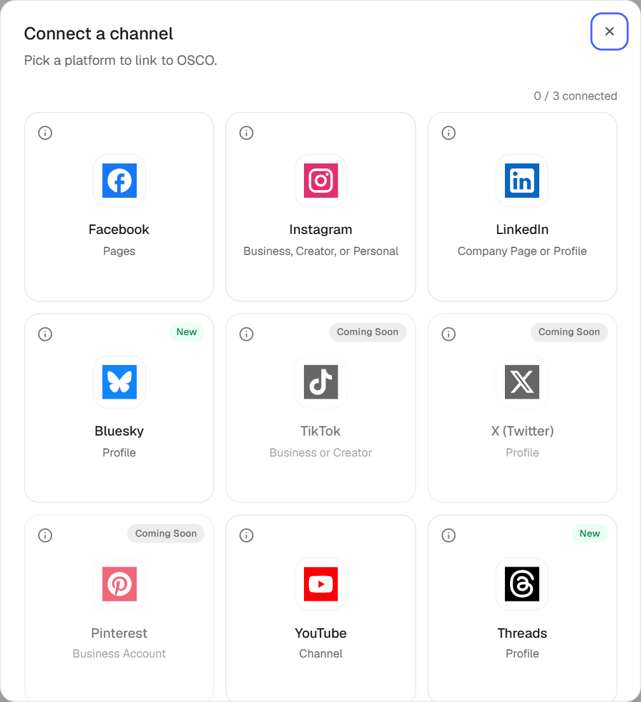
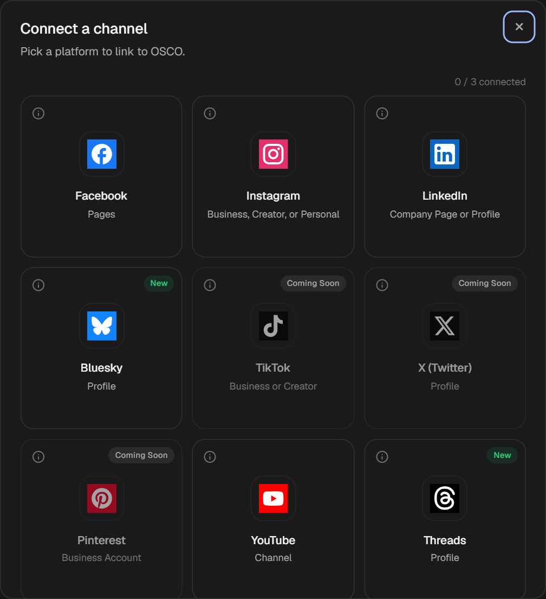

Each channel you connect appears in the sidebar and can receive posts. Your plan sets [how many you can connect](/plans/compare-plans).

## Supported platforms

| Platform | What you connect | How you connect |
|---|---|---|
| [Facebook](/channels/facebook) | Pages | Log in with Facebook |
| [Instagram](/channels/instagram) | Professional accounts (Business or Creator) | Log in with Instagram, or through Facebook |
| [LinkedIn](/channels/linkedin) | Your personal profile | Log in with LinkedIn |
| [Threads](/channels/threads) | Your profile | Log in with Threads |
| [YouTube](/channels/youtube) | Channels | Log in with Google |
| [Bluesky](/channels/bluesky) | Your profile | Your handle and an app password |
| [Telegram](/channels/telegram) | Groups and channels | A bot you create |

Platforms marked **Coming Soon** in the connect window can't be connected yet.

<Frame caption="Pick a platform in the connect window">
  
  
</Frame>

## Open the connect window

Use any of these:

- In the sidebar, select **+** next to **Social media** or **Messaging**.
- Select **Create**, then **Link Platform**.

The top of the window shows how many of your plan's slots you've used. To read about a platform before connecting it, select the **i** on its card.

<Note>
  Social channels and messaging channels have separate limits on each plan. If every slot is in use, disconnect a channel or [upgrade your plan](/plans/change-your-plan).
</Note>

<Card title="Manage your channels" icon="sliders" href="/channels/manage" horizontal>
  Pause, check, reconnect or disconnect a channel.
</Card>
