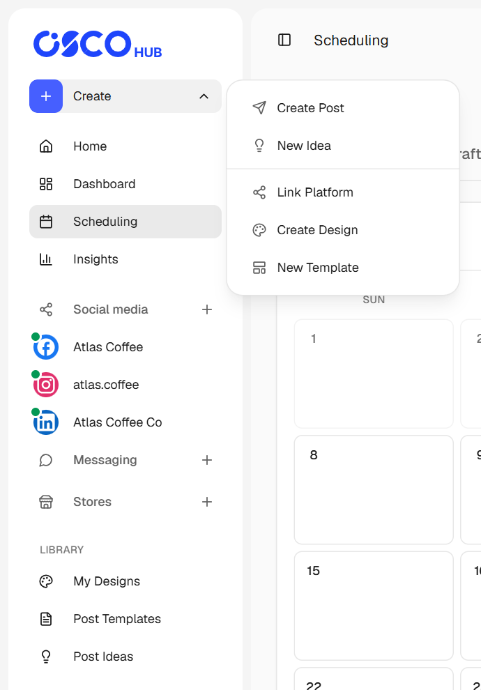
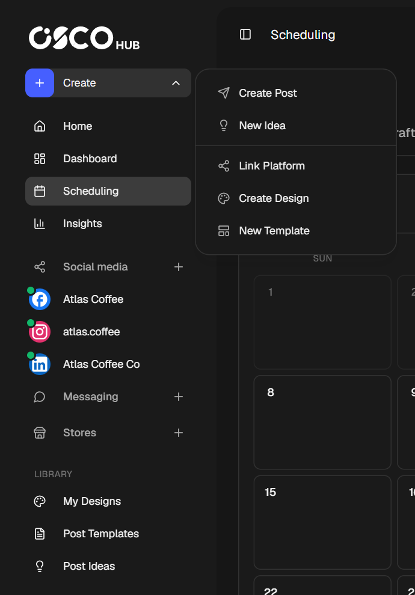

<Frame caption="The sidebar, with the Create menu open">
  
  
</Frame>

## The sidebar

| Item | What it's for |
|---|---|
| **Create** | Start a post, an idea, a design or a template, or link a new platform. |
| **Home** | Your shortcuts, your next scheduled posts and your channels. |
| **Dashboard** | Counts and charts of your posts, plus how much of your plan you've used. |
| **Scheduling** | Every post across all your channels, as a calendar or a list. |
| **Insights** | How your published posts performed. |
| **Social media** | Your connected social channels. Select **+** to add one. |
| **Messaging** | Your connected Telegram groups and channels. Select **+** to add one. |
| **Stores** | Your connected WooCommerce stores. Select **+** to add one. |
| **My Designs**, **Post Templates**, **Post Ideas** | Your [library](/library/designs) of reusable material. |

A green dot on a channel means it's active. A channel that has a problem shows up under the plug icon at the bottom of the sidebar, marked **Needs attention**.

Selecting a channel opens its own page, with the same tabs as **Scheduling** but only that channel's posts.

## Search

On **Home**, press <kbd>Ctrl</kbd> + <kbd>K</kbd> to search pages, channels and stores.

## The top bar

| Item | What it's for |
|---|---|
| **Upgrade** | Compare plans and change yours. |
| **Usage ring** | Your plan and how much you've used. It turns amber at 80% and red once you reach a limit. |
| **Bell** | Your notifications, such as a post that failed or was published. |
| **Your picture** | Account menu: settings, language, theme, help and sign out. |

## Settings

Select the gear icon at the bottom of the sidebar to open your account pages, plan and billing, and help.
