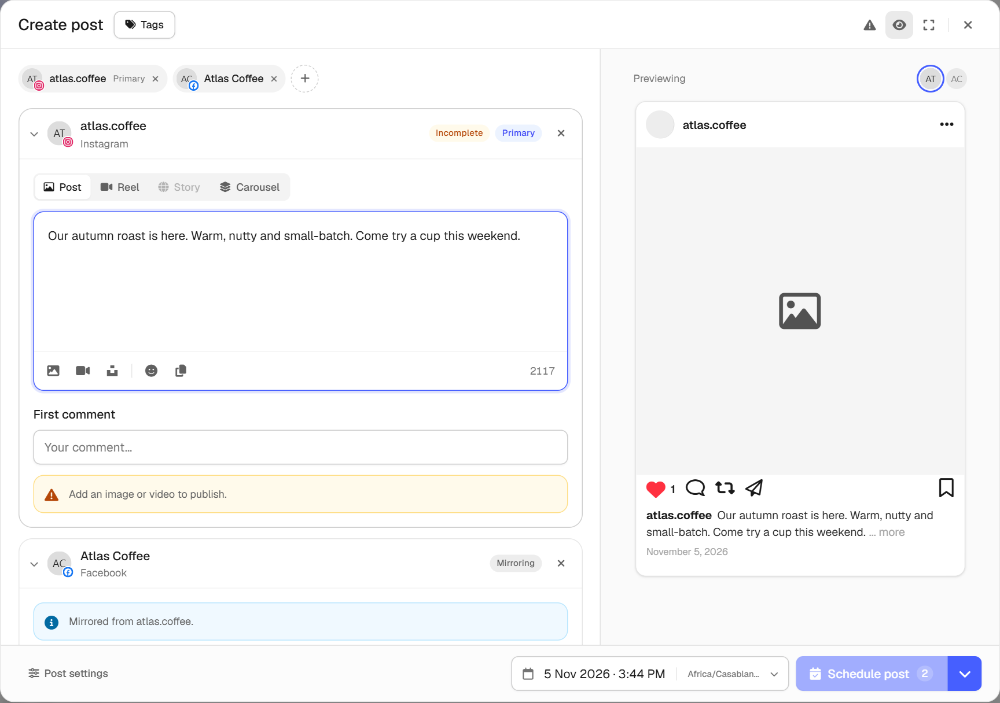
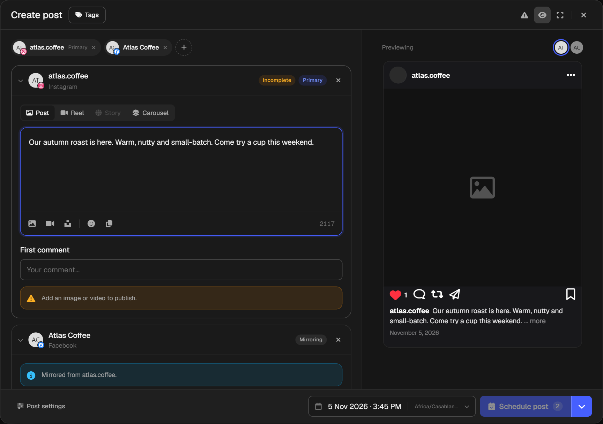

Select **Create**, then **Create Post**. You can also select **New Post** on the **Scheduling** page or on a channel's page.

<Frame caption="The post window, with a preview on the right">
  
  
</Frame>

## Choose your channels

Select **Choose channels** and pick one or more. Each channel gets its own section in the window. Each channel also counts as one post against your [plan's limits](/plans/limits#how-posts-are-counted), and the window tells you if your plan has fewer posts left than you've selected.

The first channel you pick is the **Primary**. The others are marked **Mirroring**, which means they copy whatever you write in the primary.

## Tailor a post for one channel

Edit a mirroring section to change it for that channel only. It's then marked as customized and stops following the primary. To undo that, re-sync it to the primary section.

<Tip>
  Platforms can treat identical posts across many accounts as spam. If you send the same text to several accounts on one platform, OSCOHub warns you so you can reword some of them. You can still publish as it is.
</Tip>

## Choose a post type

Each platform offers its own types, such as **Post**, **Reel**, **Story** and **Carousel** on Instagram. The type decides what media and text the post can have. See [formats and limits](/posts/formats-and-limits).

## Write and add media

The toolbar under the text box lets you:

- Add images or videos from your device.
- Search free photos from Unsplash.
- Add an emoji.
- Insert one of your [post templates](/library/post-templates).

The number in the corner shows how many characters you have left on that platform.

## Edit an image

Hover over an image you've added and select **Adjust aspect ratio** to crop it. From there, select **Open Advanced Image Studio** for filters, text, stickers and more. See [designs and the image studio](/library/designs).

If an image's shape doesn't suit the post type, you'll see a warning. Select the warning icon at the top of the window to show or hide these warnings.

## Optional extras

| Option | Where | What it does |
|---|---|---|
| **First comment** | Under the text box | Publishes a comment on your post right after it goes out. Available on [some post types](/posts/formats-and-limits). |
| **Tags** | Top of the window | Labels the post so you can filter by it in **Scheduling** and **Insights**. Create new tags as you go. |
| **Campaign name** | **Post settings** | Groups related posts. You can filter by campaign in **Scheduling**. |
| **Internal notes** | **Post settings** | Notes for yourself. They aren't published. |
| **Recurring post** | **Post settings** | [Repeats the post](/posts/repeat-a-post) daily, weekly or monthly. |

## Options for each platform

<AccordionGroup>
  <Accordion title="YouTube">
    Add a title, which is required, and optionally a custom thumbnail. You can also set the category, visibility (public, unlisted or private), license, whether to notify subscribers, whether the video can be embedded, and whether it's made for kids.

    If your video has realistic altered or AI-generated content, turn on the disclosure. YouTube asks you to say so when realistic people, places or events were made or meaningfully changed with AI or other tools, and it shows viewers a label.
  </Accordion>
  <Accordion title="Telegram">
    **Enable HTML formatting** supports bold, italic, code, links and spoilers. Turn it off to send literal text.

    **Pin this message in the chat** pins it silently after publishing, and unpins the previous message OSCOHub pinned in that chat.
  </Accordion>
  <Accordion title="Instagram reels">
    You can upload a cover image for a reel.
  </Accordion>
  <Accordion title="Threads and Bluesky threads">
    Choose the **Thread** type, then add more posts to the chain. Each one has its own text limit.
  </Accordion>
</AccordionGroup>

## Check the preview

The panel on the right shows roughly how the post will look on each platform. Select a channel's picture above it to switch between previews.

An **Incomplete** label means a section still needs something before it can publish, and the section tells you what. Every channel must be complete before you can publish.

<Card title="Publish or schedule your post" icon="calendar-check" href="/posts/publish-and-schedule" horizontal>
  Send it now, pick a time, or save a draft.
</Card>
