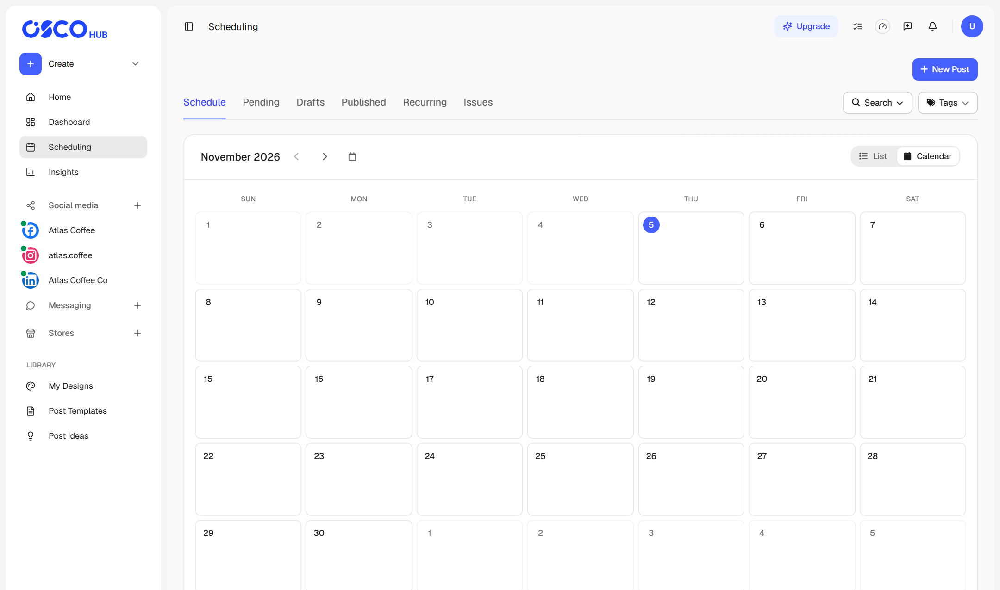
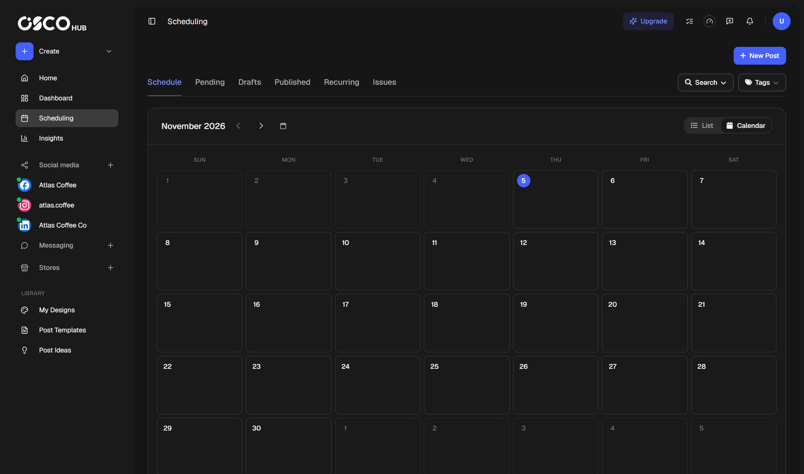

**Scheduling** shows every post across all your channels. A channel's own page has the same tabs, showing only that channel's posts.

<Frame caption="The Scheduling page in calendar view">
  
  
</Frame>

## The tabs

| Tab | What's in it |
|---|---|
| **Schedule** | Your posts on a calendar. Switch to **List** to see them as a list. |
| **Pending** | Posts waiting for their time, being published, or paused. |
| **Drafts** | Posts you saved to finish later. |
| **Published** | Posts that went out. |
| **Recurring** | Your [repeating posts](/posts/repeat-a-post). |
| **Issues** | Posts that failed or were cancelled. |

## Find a post

Use **Search** to look through a post's content or title, or to filter by category, campaign, date range and tags. Use **Tags** to filter by tag.

## What you can do with a post

Open the menu on a post card. The options depend on the post's state.

| State | Options |
|---|---|
| **Pending** | Edit Post, Duplicate, Publish Now, Move to Draft, Delete |
| **Draft** | Edit Post, Duplicate, Move to Schedule, Publish Now, Delete |
| **Published** | Duplicate, Delete Local Only, Delete from Social Media |
| **Recurring** | Stop recurring, Duplicate, Delete |
| **Issues** | Retry (on failed posts), Delete |

**Duplicate** creates a copy you can change and publish separately.

## Retry a failed post

Failed posts appear under **Issues** with the reason. Fix the cause first if there is one, such as [reconnecting the channel](/channels/manage#reconnect-a-channel), then select **Retry**. If it fails again, it returns to **Issues** with the new error.

See [troubleshooting](/help/troubleshooting#a-post-failed-to-publish) for what each reason means.

## Delete a post

For a post that's already published, you have two choices:

- **Delete Local Only** removes it from OSCOHub. It stays live on the platform.
- **Delete from Social Media** removes it from both OSCOHub and the platform.

Neither can be undone.

<Note>
  Instagram doesn't let apps delete posts from accounts connected directly. For those posts, open the post on Instagram and delete it there. OSCOHub then offers to remove its own copy.
</Note>

Deleting a published post doesn't give you back the post it used on your plan. Deleting one that hasn't gone out yet does. See [how posts are counted](/plans/limits#how-posts-are-counted).

## Open a published post

Select **View Post** on a published post to open it on the platform. Select **Preview** to see it in OSCOHub with its details. To see how it performed, [open it in Insights](/insights/overview#one-post).

## Older posts

OSCOHub deletes a post's full-size media 90 days after publishing. The post, a smaller preview and the link to the platform all stay, and the copy on the platform isn't affected. Keep your own copy of any media you may want to reuse.
